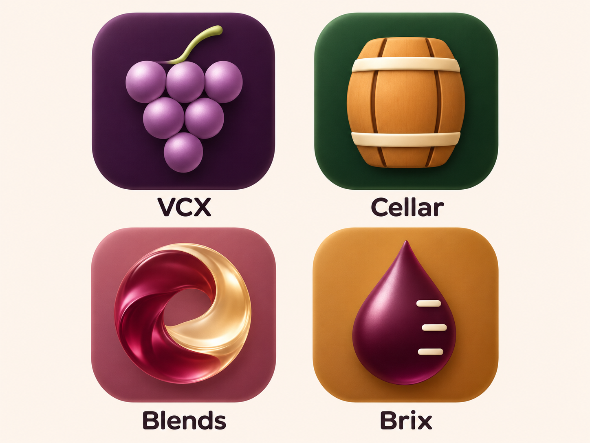

# VCX y sus productos · redacción para el sitio público

Revisión: 2026-11-11. Estado: redacción y encabezado aprobados por el usuario; integración publicada y verificada el 2026-11-11 ([evidencia](README.md#publicación-verificada)). Destino: hoja de productos de `hello.tintum.app`. Pedido: presentar VCX, Cellar, Blends y Brix con sus isotipos y justificaciones.

## Encabezado de Tintum

**Título:** Productos digitales con raíces en el vino.

**Texto:** Experiencias para disfrutarlo y herramientas para crear. Tintum reúne a Teyst, Salmanazar, Pinot Index y la familia VCX: productos con identidad propia y una inspiración compartida.

**Acción:** Explorar los productos.

Este encabezado amplía el actual «Productos digitales para quienes disfrutan el vino» para incluir herramientas de desarrollo sin presentarlas como software de gestión vitivinícola. Su adopción forma parte de esta propuesta.

## VCX

**Categoría:** Familia de productos para crear software.

**Título:** De una idea a un proyecto con historia.

**Texto:** Crear software requiere método, herramientas y memoria. VCX reúne a Cellar, Blends y Brix para acompañar ese recorrido: dar forma a las ideas, trabajar con criterios claros y conservar lo aprendido. Tres productos con responsabilidades propias, bajo la marca Tintum.

**Acción:** Conocer la familia → las tres fichas de esta misma página.

**El racimo:** Cada uva conserva su identidad y forma parte de un conjunto. El racimo representa la relación entre los productos de VCX y el potencial de las ideas desde su origen.

**Texto alternativo del isotipo:** Racimo de uvas violetas sobre fondo ciruela, símbolo de VCX.

## Cellar

**Categoría:** Contexto y continuidad de proyectos.

**Título:** Que tus proyectos conserven su historia.

**Texto:** Una idea cambia cuando se convierte en proyecto. Cellar propone una estructura para organizar su contexto, decisiones y evidencia, y acompañar su evolución junto a las personas responsables. Su punto de partida son plantillas documentales para construir una memoria que se pueda consultar y continuar.

**Disponibilidad:** Documentación y plantillas disponibles.

**Acción:** Explorar Cellar → <https://github.com/denispaiva/cellar>

**La barrica:** La crianza combina cuidado y transformación. La barrica expresa esa continuidad: conservar lo valioso mientras el proyecto evoluciona. El roble y el verde profundo le dan una identidad propia dentro de la familia.

**Texto alternativo del isotipo:** Barrica de madera con aros claros sobre fondo verde, símbolo de Cellar.

## Blends

**Categoría:** Método para convertir ideas en proyectos.

**Título:** Distintos aportes. Una dirección compartida.

**Texto:** Blends define un método para que personas, equipos y agentes trabajen sobre una idea con etapas, roles y criterios de evidencia claros. Reúne estándares y propuestas de proceso para explorar, revisar y preparar el paso a proyecto, con las decisiones en manos de sus responsables.

**Disponibilidad:** Estándares y documentación disponibles.

**Acción:** Explorar Blends → <https://github.com/denispaiva/blends>

**El ensamblaje líquido:** Dos corrientes se encuentran en un movimiento común. El símbolo evoca la combinación de aportes, el ajuste y la iteración necesarios para lograr un resultado coherente.

**Texto alternativo del isotipo:** Remolino de líquido granate y dorado sobre fondo rosado, símbolo de Blends.

## Brix

**Categoría:** Herramientas de ingeniería.

**Título:** Instrumentos para avanzar con evidencia.

**Texto:** Brix reúne herramientas de línea de comandos para evaluar tooling, generar especificaciones y preparar operaciones de desarrollo. Permite trabajar con entradas explícitas y revisar los resultados: desde una evaluación de herramientas hasta la preparación de un repositorio independiente.

**Disponibilidad:** CLI disponible desde su repositorio.

**Acción:** Explorar Brix → <https://github.com/denispaiva/brix>

**La gota y la escala:** Una gota de mosto y sus marcas de medición expresan observación, precisión y evidencia. El nombre remite a la concentración de azúcar y su relación con el alcohol potencial: una referencia al valor de medir antes de decidir.

**Texto alternativo del isotipo:** Gota ciruela con marcas claras de escala sobre fondo ámbar, símbolo de Brix.

## Familia visual

La lámina integra la dirección visual elegida. Los párrafos «El racimo», «La barrica», «El ensamblaje líquido» y «La gota y la escala» son adaptaciones públicas breves de los [fundamentos de marca](brand-rationale.md), que conservan la explicación canónica. Si cambia esa fuente, revisar sus adaptaciones aquí antes de publicar.

## Indicaciones para la integración

- Presentar VCX como encabezado de familia y a Cellar, Blends y Brix como tres fichas pares. No ofrecer instalación, acceso o suscripción a un producto ejecutable llamado VCX.
- Mostrar nombre, categoría, título, texto, disponibilidad y acción en cada ficha. Reservar la justificación del isotipo para un desplegable accesible «Sobre el símbolo»; la explicación de marca acompaña la función del producto.
- Mantener los isotipos junto a sus nombres. La lámina actual es una referencia conjunta: las [piezas individuales](README.md) ya están producidas; las variantes pequeñas siguen pendientes. No sustituirlas por los símbolos de la primera exploración.
- Las acciones apuntan a documentación y repositorios; no ofrecer una aplicación web de Cellar o Blends ni instalación desde npm para Brix.
- La presentación pública usa VCX conforme al pedido de esta revisión. No modifica el acuerdo de nombre VibeOS ni las responsabilidades de los productos.

## Fuentes y comprobación editorial

Fuentes consultadas el 2026-11-11: [README de VCX](../../README.md), [Cellar](https://github.com/denispaiva/cellar#readme), [Blends](https://github.com/denispaiva/blends#readme), [Brix](https://github.com/denispaiva/brix#readme) y [fundamentos visuales](brand-rationale.md). El contenido público propuesto se apoya en las definiciones de cada producto; la revisión documental no constituye una prueba de ejecución de Brix.

La disponibilidad distingue las plantillas de Cellar, el método documentado de Blends y la CLI de Brix. Los flujos objetivo de admisión, consejo y coordinación automática no se anuncian como implementados. El símbolo de Brix no promete medir alcohol ni calidad del vino; Blends representa ensamblaje.

El usuario aprobó esta redacción y el encabezado, y autorizó producir los isotipos individuales e integrarlos para publicar en hello.tintum.app. Esta autorización corresponde a la familia VCX y es independiente de la aprobación histórica de Pinot Index.
