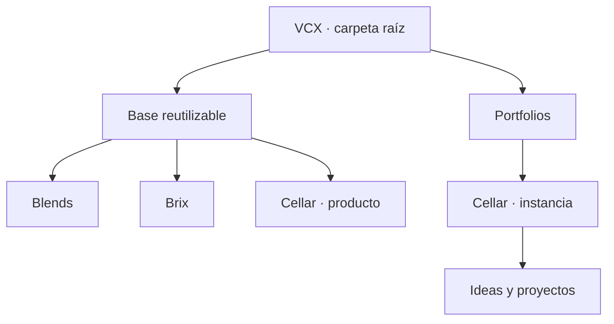

# Arquitectura de VCX

Estado: arquitectura fundacional; ver los estados particulares en el [registro de decisiones](../decisions/README.md).

## Raíz organizativa y productos desacoplados

Acuerdo VCX-D024, precisado el 2026-10-30: `vcx/` actúa como carpeta raíz del workspace. VCX puede ser el nombre comercial o propuesta de marketing del conjunto, sin convertirse en producto. El sistema en `../blends/`, relativo a la raíz de VCX, es su precursor; `blends/` dentro de VCX contiene hoy el contexto documental objetivo. VCX-D026 acuerda continuar el mismo repositorio mediante un clon local y una transición futura de copia canónica, no crear una historia nueva de Blends. La raíz conserva navegación, acuerdos y referencias compartidas durante la preparación, sin convertirse en una aplicación, paquete obligatorio, servicio o plano de control central.

El desacople como producto es el objetivo acordado. Compartir carpeta no exige compartir repositorio, versión, build, despliegue ni dependencias internas. Cada producto debe poder desarrollar, verificar, distribuir y actualizar su capacidad fuera de VCX con sus dependencias públicas declaradas. Los principios adoptados se distribuyen por un mecanismo explícito cuando sea necesario, no mediante una dependencia de ejecución de la carpeta raíz.

## Dos grupos y tres productos

**A** reúne la base reutilizable: [Blends](../../blends/README.md), [Brix](../../brix/README.md) y [Cellar](../../cellar/README.md). **B** reúne las ideas y proyectos de cada portfolio, contenidos lógicamente en instancias de Cellar.

Cellar como producto define organización y mecanismos de custodia. Un Cellar concreto conserva las iniciativas, configuración y memoria de un equipo o propietario. Cada iniciativa mantiene un contexto propio; sus relaciones se expresan mediante referencias explícitas.

El diagrama expresa organización documental y pertenencia lógica; sus flechas no representan dependencias de ejecución, imports ni una topología Git.

## Fronteras y contexto

Blends es dueño del método y coordina el tramo de idea; incluye lógica de proceso además de interfaz. Brix ofrece motores e instrumentos reutilizables. Cellar ofrece estructura, configuración, custodia y portabilidad del portfolio, y conduce los proyectos graduados bajo ese método. La [matriz](responsibility-matrix.md#1-método-y-conducción) es la fuente de esa frontera, derivada de VCX-D029; el reparto no rige en el sistema existente hasta conciliar por VCX-D011.

Brix es el núcleo de capacidades técnicas. La denominación histórica **Blends Kernel** pertenece al núcleo de gobierno del sistema existente; esta documentación no la reasigna.

La entrada de cada contexto es su README y sus instrucciones locales. El contexto adicional se carga según la tarea y sus dependencias, no por compartir repositorio. La [matriz](responsibility-matrix.md) detalla responsabilidades y la [interoperabilidad](interoperability.md) delimita las interfaces.

Blends, Brix y Cellar también tienen contexto propio como proyectos de desarrollo. Su gestión puede pertenecer a un Cellar sin duplicar su implementación ni su seguimiento. Aún no se creó ese Cellar ni se cambió el seguimiento del sistema existente.

## Código, estado y localización

El código de cada producto y de cada proyecto vive en su propio repositorio, según VCX-D029; el Cellar registra su ubicación canónica, incluidas ubicaciones externas, sin alojarlo. Un índice de localizaciones no replica el contenido de los roadmaps.

El backlog actual de blends vive en la rama `queue`, y sus decisiones y evidencia incluyen historia fuera del checkout principal. Una migración futura deberá declarar esos almacenamientos, preservar identidades y probar recuperación. Esta etapa no crea una copia de ese estado.

La configuración debe distinguir reglas generales del producto, parámetros de cada Cellar y controles del repositorio o entorno de ejecución. La configuración de un portfolio no concede autoridad sobre otros productos o repositorios.

## Repositorios y desacople

Decisión VCX-D025: Blends, Brix y Cellar tendrán repositorios independientes, organizados localmente bajo `vcx/`. La raíz tendrá su propio repositorio documental para principios, visión, arquitectura, interoperabilidad, decisiones y nombres. Versionar estos acuerdos no convierte a VCX en producto.

En el estado estable, el repositorio raíz ignorará `/blends/`, `/brix/` y `/cellar/`, sin repositorios embebidos ni submódulos. VCX-D026 admite temporalmente sus documentos actuales en el commit base raíz; se congelan al transferirse y se retiran del seguimiento por producto después de comprobar su incorporación integrada. El mecanismo elegido es ese commit base, no una instantánea externa equivalente. Cada producto conservará su documentación, contratos propios, código, verificaciones, versiones y entregas. Cuando un acuerdo requiera identificar versiones adoptadas, registrará sus referencias concretas sin convertirlas en un lockstep de todos los productos. La ubicación y versionado de instancias de Cellar siguen pendientes; la topología no autoriza crear instancias ni incluir sus datos en el repositorio raíz.

Esta decisión sustituye la propuesta inicial de monorepo modular de VCX-D004 para estos productos. Los disparadores propuestos de VCX-D013 no condicionan su separación. Inicializar repositorios, configurar remotos o ejecutar extracciones siguen requiriendo su alcance de ejecución; la estructura continúa siendo documental. El 2026-10-31 se autorizó e inicializó Git únicamente en la raíz, en `main`, para el commit base; al corte documental previo a ese commit, su preservación y recuperación aún están pendientes de comprobar. Los productos no tienen Git inicializado en VCX.

El desacople documental aún no está resuelto: la revisión del 2026-10-30 encontró 25 enlaces Markdown fuera de Blends, 13 fuera de Brix y 18 fuera de Cellar. Son ocurrencias de enlaces a destinos fuera del directorio del producto, no un inventario de dependencias de código ni una prueba de funcionamiento. Antes del primer clon independiente, resolver los [contratos y principios distribuibles](interoperability.md#preparación-de-productos-independientes) y sustituir los enlaces de trabajo que requieran la carpeta padre o productos hermanos. Los enlaces públicos y antecedentes identificados como tales pueden permanecer; ningún contexto necesario debe depender de una ruta local externa.

Blends continuará el repositorio del precursor con historia y referencias requeridas, incluida `queue`, mediante clon desde la copia local con origen de transferencia separado de GitHub y sin objetos prestados. La carpeta original sigue en solo lectura; cualquier escritura futura se autoriza por alcance para el clon nuevo, bajo el gobierno vigente. La coexistencia de reglas actuales, contexto objetivo y datos de portfolio es deuda transitoria, no independencia demostrada. La secuencia de congelamiento, incorporación, corte de escritores y recuperación se mantiene en el [mapa](repository-map.md#secuencia-acordada-para-preservar-y-versionar).

Para Brix, antes de extraer código del precursor, registrar origen y revisión, alcance de extracción, estrategia de conservación de historial y verificación de procedencia. Brix nace de `../blends/vc/brix/`, relativo a la raíz de VCX. Elegir si se combina la documentación de VCX con historia extraída de ese subárbol o se comienza documentalmente con procedencia y una extracción posterior es una decisión pendiente de Brix que no bloquea a Cellar o Blends; no es un comando autorizado. Las decisiones y evidencia fuera de ese subárbol deben identificarse para no perder su procedencia.

Separar carpetas o repositorios no demuestra independencia. Cada producto debe superar un ensayo de clon aislado con sus instrucciones y documentación accesibles, contratos y dependencias declarados, y verificaciones aplicables, sin acceder a la raíz local ni a implementaciones internas de sus vecinos.

## Pruebas de independencia para la implementación futura

- Blends administra un Cellar distinto, sin nombres de iniciativas o rutas históricas incrustadas.
- Un proyecto consume Brix fuera de VCX y sin instalar Blends, con entradas, configuración y permisos explícitos.
- Un Cellar permite recuperar estado, decisiones y evidencia desde sus almacenamientos declarados, sin ejecutar Blends o Brix.
- Un Cellar conduce un proyecto sin ejecutar Blends, con el método adoptado disponible como recurso versionado.
- Las instancias mantienen aislamiento efectivo y una actualización compatible de un producto no fuerza la actualización de todos los consumidores.
- Los consumidores usan interfaces públicas; no dependen de archivos internos de otra pieza.

Estas pruebas definen resultados futuros. Todavía no hay implementaciones nuevas en esta estructura que las demuestren.
